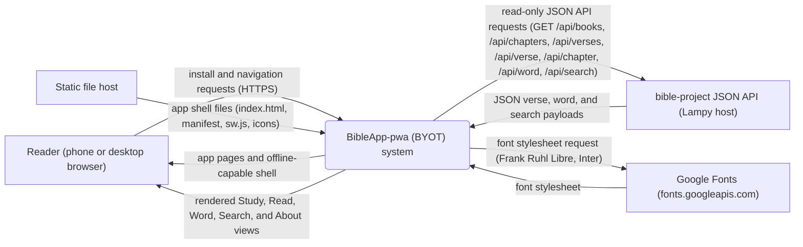
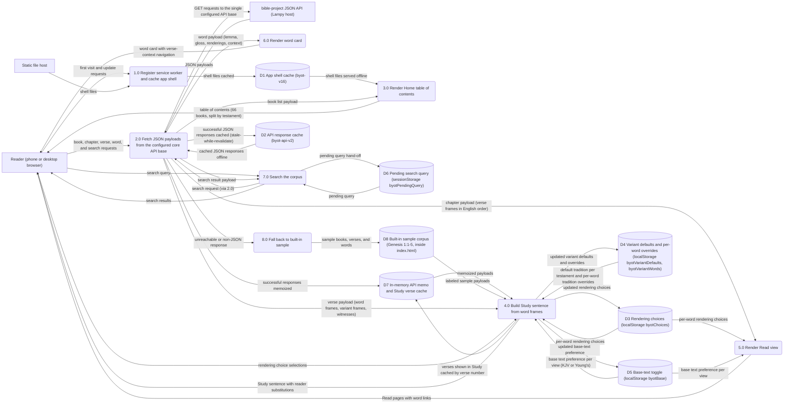
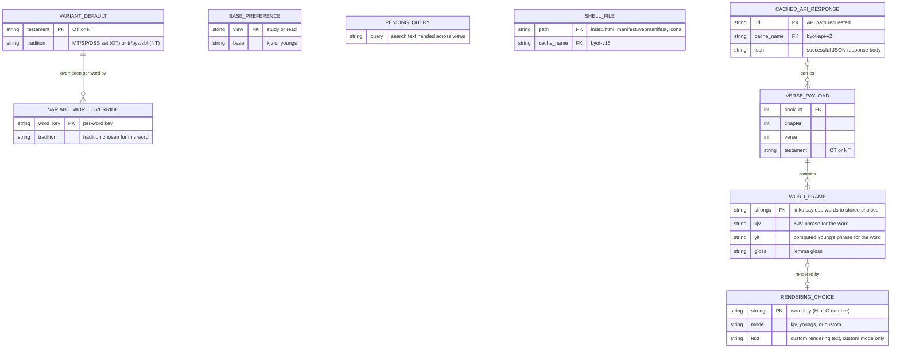
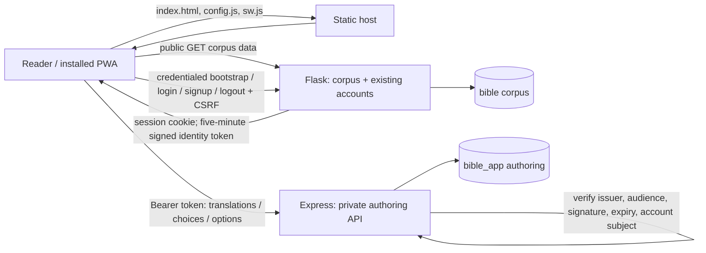

Living document — update these diagrams when adding features.

# BibleApp-pwa — Architecture

**Build Your Own Translation (BYOT)** as an installable progressive web app: one static page (`index.html` — data, routes, styles, and script in a single file), a web app manifest, and a service worker. No build step and no server code of its own: any static host can serve the folder, including from a subpath. It is the reader client of the **bible-project** corpus: all Bible data arrives through bible-project's read-only JSON API (see bible-project's `docs/architecture.md`, Phase 3 API). This document was created in the 2026-11-07 diagram-maintenance run — the first architecture doc for this repo (created 2026-11-03; HEAD at writing `d915f4ac`, service-worker cache `byot-v17`).

The app has six views — Home (table of contents), Study (build-a-translation sentence), Read, Word (word card), Search, and About — covering the 66-book canon (OT 39 / NT 27, KJV order). Hebrew-track verses are built from the API's word frames; Greek-track (NT) verses from its `greek_words` frames, with Byzantine/SBLGNT variant frames swapped in when the reader's default tradition is not TR. When the API is unreachable the app falls back to a **labeled built-in sample (Genesis 1:1–5 only)** — nothing is invented beyond it — and the footer follows the data state (sample notice only while sample data is on screen; "Connected to the Bible database." when live).

## 1. Context diagram (level 0)

The static host is inside the delivery path only: it serves the shell once (and on updates); after the service worker registers, repeat visits are served from the shell cache. The system boundary is the app as delivered to the browser (page + service worker + browser storage); the API and its database are outside it. The only other third-party runtime fetch is the Google Fonts stylesheet linked in the page head (Frank Ruhl Libre for headings, Inter for body).

## 2. Level-1 data flow diagram

Process grounding (all in `index.html` unless noted): 1.0 registers `sw.js` on window load; the worker precaches the shell (`./`, `index.html`, `manifest.webmanifest`, four icons) cache-first under `byot-v16`, deletes non-keep caches on activate, and claims clients. 2.0 is the `apiGet`/`apiTry` layer: `API_BASES` in probe order — `https://laptop.taila7a335.ts.net:8443/bible` (public funnel), `https://laptop.taila7a335.ts.net/bible` (tailnet), `/bible` (same-host) — all reaching the same API; a base that answers stays selected for the session (`apiBaseIdx`); 8 s timeout per try; only successful results are memoized; after a failure the same path is not retried for 30 s (`API_COOLDOWN_MS`). Response classification: non-JSON (including an HTML 404 from a plain static server) = unreachable; JSON `{"error":"not found"}` with HTTP 404 = authoritative not-found, **no sample fallback**. API GETs are also cached by the service worker under `byot-api-v2` (stale-while-revalidate, successful JSON only; 503 when offline with no cache). 4.0 builds the Study sentence in English order from the verse's actual Young's text with the reader's choices substituted at each word's own phrase (KJV base = `kjv_sentence` anchor spans); under a non-TR default tradition the frames are that tradition's own (`greek_words_variants` byz/sbl arrays, with that tradition's bridge KJV/computed-Young's phrases). Choice semantics (`effective()`): a stored choice is `kjv`, `youngs`, or custom text; the default mode is KJV in Read and Young's in Study. 8.0 serves only the Genesis 1:1–5 sample, always labeled.

## 3. Entity–relationship diagram (browser-side data)

The app owns no server data. Its persistent data is browser storage: two service-worker caches and four Web Storage keys. Payload entities are the API's shapes as consumed (see bible-project's ERD for the server schema); only the fields this app reads are shown.

Notes on the ERD: Web Storage keys are JSON objects, not tables — `byotChoices` maps a word's Strong's key to its choice (`mode` + optional custom `text`), `byotVariantDefaults` maps testament → tradition, `byotVariantWords` maps a per-word key → tradition, `byotBase` maps view → base text; `byotPendingQuery` (sessionStorage) is a single transient value, drawn as an entity for completeness. The storage keys share no storage-level foreign keys — the relationships above are the app's own logical links (a choice applies to a word frame by its Strong's key; an override refines a default). `SHELL_FILE` and `PENDING_QUERY` stand unconnected because nothing in storage references them by key. Cache names are versioned (`byot-v16`, `byot-api-v2` at HEAD) and old caches are deleted on worker activation.

## Grounding notes

- OBSERVED (README.md): one static page (`index.html` — "the whole app (data, routes, styles, script)"), installable PWA for iPhone/Android, no build step, any static host incl. subpath; HTTPS or localhost required for install/offline; viewed verses are kept in the phone's cache and reopen offline; rendering choices are saved on the phone (localStorage). README's file list names `manifest.webmanifest` and `sw.js` (its cache names there — `byot-v2` / `byot-api-v2` — are stale against the code at HEAD; see the sw.js bullet).
- OBSERVED (README.md, "Live data"): the app reads the Bible database only through the read-only GET JSON API on the same host as the app, base path constant `API_BASE` default `/bible`; endpoints used: `/api/books`, `/api/chapters/<book>`, `/api/verses/<book>/<chapter>`, `/api/verse/<book>/<chapter>/<verse>`, `/api/chapter/<book>/<chapter>`, `/api/word/<Strong's>`, `/api/search?q=<text>`; fallback rules as drawn in 2.0/8.0 (sample is Genesis 1:1–5 only; JSON 404 = not found, no sample; successes kept in memory; 30 s retry cooldown). The README's single-base description is superseded in detail by the `API_BASES` probe list observed in `index.html` at HEAD (three bases, session-sticky).
- OBSERVED (`index.html` at HEAD `d915f4ac`): the `API_BASES` array and probe/sticky/timeout/cooldown/memo rules quoted in the process grounding; the six view functions (`viewHome`, `viewStudy`, `viewRead`, `viewWord`, `viewSearch`, `viewAbout`); the choice store (`byotChoices`; `effective()` defaults: Read → KJV, Study → Young's; custom mode returns the stored text); variant stores (`byotVariantDefaults`, `byotVariantWords`); base toggle store (`byotBase`, sticky per view); search hand-off (`byotPendingQuery`, sessionStorage); service-worker registration of `sw.js` on load; the sample fallback block ("SAMPLE FALLBACK (Genesis 1:1–5 only)"); OT traditions named in code (Masoretic base, Samaritan Pentateuch witness "SP", DSS); NT variant frames consumed from `greek_words_variants` with per-tradition bridge phrases and "verse not present in this tradition" notes; footer text following the data state; the Google Fonts stylesheet link in the page head (Frank Ruhl Libre 400/500/700, Inter 400/500/600); the in-memory `verseCache` Map keyed `"v<n>"` holding verses shown in Study.
- OBSERVED (`sw.js` at HEAD): shell cache `CACHE = "byot-v16"`, API cache `API_CACHE = "byot-api-v2"`, `KEEP = [CACHE, API_CACHE]`; shell precache list (`./`, `index.html`, `manifest.webmanifest`, `icon-180.png`, `icon-192.png`, `icon-512.png`, `icon-maskable-512.png`); API paths (pathname containing `/api/`) get stale-while-revalidate with only successful JSON cached and a plain-text 503 when offline with no cache; shell URLs cache-first; everything else network-first with cache fallback (successful and opaque responses kept).
- OBSERVED (`manifest.webmanifest` at HEAD): name "Build Your Own Translation", short_name "BYOT", `start_url`/`scope`/`id` relative (`.` / `./`), display `standalone`, orientation `portrait`, theme `#2B2118`, background `#FFFCF0`, four icons (192/512 any, 512 maskable, 180).
- OBSERVED (commit history, 2026-11-03/04/07): repo created 2026-11-03 from the round-4 prototype (492eab6b) with manifest/icons/SW byot-v1; live API client + sample fallback (8d8bf974); dual-base probe (e7b62455 — the third, same-host base is in the HEAD code); NT client with 66-book canon and G-number cards (222c9dda, 35b979a6); default-variant dropdowns sticky per testament + per-word overrides (b16f0e30); Study sentence rebuilt in English order and KJV/Young's base toggle sticky per view (3ea56403, 7e90d722); word-page Renderings panel from the API's corpus-wide phrase lists (97c55fe2); About tab with repo and license roll (bf5075b3); variant traditions speaking with their own bridge phrases (d915f4ac, 2026-11-07, HEAD).
- INFERRED: the DFD process boundaries group the single file's functions by view/feature; the repo has no module boundaries to observe. `VERSE_PAYLOAD` / `WORD_FRAME` attribute lists show only the fields the client code reads by name; the authoritative payload schema is bible-project's.

## 2026-11-08 portability change: deployment-configured API base

The client now loads `config.js` before its inline application code. That file sets `window.BIBLEAPP_API_BASE`; the default is the same-origin `/bible` path to preserve the existing Lampy-hosted deployment. A separate host can configure an HTTPS API origin/path without editing the application code.

The client now calls exactly one configured API base. The hard-coded Lampy Funnel and tailnet URLs and the session-sticky fallback probe have been removed. If the configured API is unavailable, the existing labeled sample/offline behavior remains; the client does not silently reach back to Lampy.

The service worker shell cache is now `byot-v17` and includes `config.js`. It fetches `config.js` network-first, updating the cached configuration when online and using the last cached configuration offline. This allows API-origin changes to take effect without pinning installed clients to an old config file. No secrets belong in `config.js`.

This is a client-side portability prerequisite only. It does not move the Flask API, corpus database, lexical data, or embedding runtime off Lampy. Cross-origin deployment still requires a deliberately configured API CORS policy and an available core API at the configured address.

## Current architecture — 2026-11-09 account-backed authoring

This section is the current architecture snapshot. Where earlier diagrams or grounding notes describe a localStorage-only client, a single API, hard-coded API probes, or older cache names, this section supersedes them.

The PWA remains a static client with no application server of its own, but the complete online workflow now spans three independently configurable service bases:

- **Corpus and account service:** Flask in `bible-project`. It serves public read-only Bible/corpus data, the existing Flask `user_accounts` login authority, JSON auth endpoints, and the non-cacheable word-ID phrase-order endpoint.
- **Authoring service:** Express in `BibleApp`. It verifies short-lived Flask-issued identity tokens and enforces translation ownership for metadata, choices, Other options, and lemma defaults.
- **Static client:** `BibleApp-pwa`. It hosts the app shell and service worker and calls each backend using a separate configured base URL.

### Authentication and authoring flow

1. The PWA obtains a pre-authentication CSRF token from Flask `GET /api/auth/bootstrap` using credentialed, no-store requests.
2. Login/signup/logout are JSON POSTs to Flask with the session cookie, exact allowed Origin, and `X-CSRF-Token`. The existing Flask account table and Werkzeug hashes remain authoritative. Successful account-state transitions rotate the session and CSRF token.
3. The PWA exchanges the authenticated Flask session for a five-minute HS256 token through `POST /api/auth/token`. The token is held only in JavaScript memory; passwords, CSRF tokens, and bearer tokens are not persisted in Web Storage.
4. Express verifies the token and uses only its verified account subject as the owner. The browser does not submit an owner ID.
5. Translation reads and writes are owner-scoped. Built-in KJV (ID 1) and Young's (ID 2) are public/read-only. New translations receive the authenticated owner server-side.
6. The PWA loads explicit Hebrew word-choice bytes and forward-only lemma defaults. It reconstructs the legacy option order from live Flask phrase data: current occurrence phrase first, then remaining KJV phrases, Young's phrases, and translation-specific Other options.
7. The PWA applies server-backed Hebrew renderings in Study and Read. Existing browser-local choices are preserved and are not automatically imported. Greek authoring is not yet supported.

### Cache and offline boundaries

- Shell cache is `byot-v19`; public API cache is `byot-api-v3`.
- Flask auth/session routes, Express `/api/bible/*` routes, requests carrying an Authorization header, and Flask `/api/word-options` bypass shared service-worker API caching.
- The word-options response is `Cache-Control: no-store`. This is correctness-critical: the stored choice byte is an index into the ordered phrase options, so stale cached phrase data could map a selection to a different rendering.
- Public read-only corpus data retains the existing offline/cache behavior. Account login, translation synchronization, and private authoring require connectivity.
- The PWA does not silently fall back to Lampy when a separately configured corpus API is unavailable.

### Deployment boundaries and outstanding work

The three origins are configured independently through `BIBLEAPP_API_BASE`, `BIBLEAPP_AUTH_BASE`, and `BIBLEAPP_AUTHORING_API_BASE` in `config.js`. Cross-origin Flask auth requires the exact frontend origin in `BIBLEAPP_ALLOWED_ORIGINS`; cross-site cookies require Secure + SameSite=None and may still be affected by browser third-party-cookie restrictions. Flask and Express must share a dedicated server-side `BIBLEAPP_IDENTITY_TOKEN_SECRET`; it is separate from the Flask session secret and sandbox token.

This implementation is staged in draft PRs and has not been activated on Lampy. Production secret provisioning, service restarts, and database changes remain separate authorized deployment steps. Before production, complete browser end-to-end tests against configured staging services, cross-user ownership tests, logout/token-expiry checks, and an explicit strategy for migrating existing localStorage choices. Persistent login throttling, account recovery/email verification, immediate bearer-token revocation, and Greek word-choice persistence remain open.
